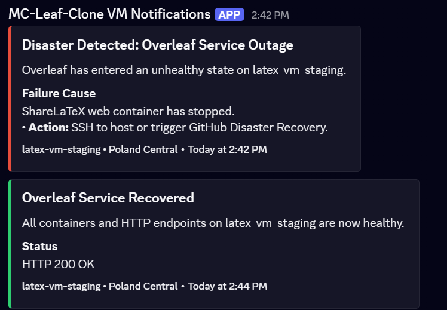
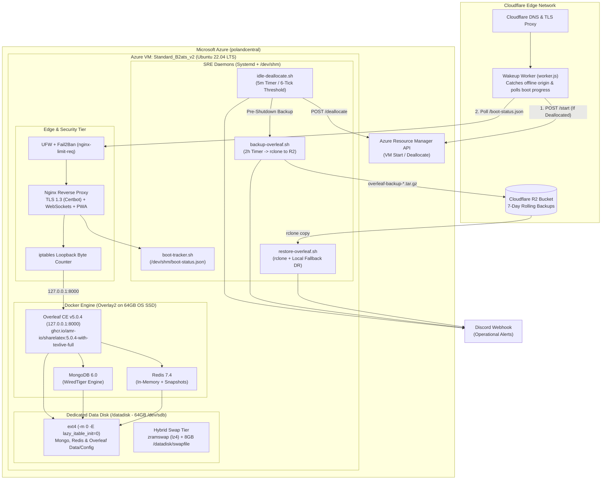

# MCLeaf — Self-Hosted, Scale-to-Zero Overleaf CE on Azure

[](#repository-layout)
[](#how-it-fits-together)
[](#kernel--storage-tuning)
[-47A141?logo=overleaf&logoColor=white)](#system-components)
[](#scale-to-zero--finops)
[](#observability--sre-alerts-slis--slos)
[](#cicd--environments)

**MCLeaf** is a production-hardened, self-hosted **Overleaf Community Edition (v5.0.4)** platform engineered to replace SaaS collaboration tools like **prism.ai** for our research group while authoring academic papers. Running the complete **TeX Live Full** suite on a cost-optimized Azure burstable instance (`Standard_B2ats_v2`), it guarantees complete data privacy for unpublished manuscripts with **automated scale-to-zero FinOps ($0/hr idle)**, **Cloudflare Edge on-demand wakeup**, **Linux kernel memory and inode tuning**, and **1-click Cloudflare R2 disaster recovery**.

---

## Why This Exists: Replacing SaaS for Research

Collaborative academic writing platforms like prism.ai or commercial Overleaf impose steep recurring subscription fees, file size caps, and third-party data hosting concerns for unpublished research drafts. 

Hosting Overleaf CE independently solves data sovereignty, but running `texlive-full` (over $150,000$ macro, font, and style files), MongoDB WiredTiger, and Redis on a single budget machine typically leads to Out-Of-Memory (OOM) crashes and disk thrashing. Leaving a high-memory VM running 24/7 wastes budget when the team isn't writing.

**MCLeaf solves both problems through four engineering pillars:**
1. **Zero Compute Cost When Idle:** A lightweight systemd daemon checks active `pdflatex` compilations, open SSH sessions, and local HTTP byte activity every 5 minutes. After $30\text{ minutes}$ of inactivity, it ships an off-site backup to Cloudflare R2, dispatches a standby notification via webhook, and deallocates the Azure VM—dropping compute costs to **$0/hr**.
2. **On-Demand Edge Wakeup:** When an author opens the site while the VM is deallocated, a **Cloudflare Worker (`worker.js`)** intercepts the request, calls the Azure ARM API to start the instance, and serves a live boot progress UI backed by RAM disk telemetry (`/dev/shm/boot-status.json`). Cold boot finishes in $105\text{--}120\text{ s}$.
3. **Burstable LaTeX Kernel Tuning:** Instead of paying for expensive RAM tiers, Ansible configures `zramswap` (`lz4` compression), an $8\text{ GB}$ dedicated disk swapfile on `/dev/sdb`, fast-inode `ext4` formatting (`-m 0 -E lazy_itable_init=0`), and targeted `sysctl` memory parameters (`vm.swappiness=100`, `vm.overcommit_memory=1`, `vm.vfs_cache_pressure=50`).
4. **Automated R2 Disaster Recovery:** Bi-hourly snapshots upload `mongodump` archives and project files to **Cloudflare R2** with 7-day retention. A 1-click GitHub Actions recovery workflow (`recovery.yml`) restores the entire stack in under 3 minutes with automated webhook verification.

---

## Observability & SRE: Alerts, SLIs & SLOs

Reliability for an academic team means never losing paper drafts and knowing immediately when an outage or backup regression occurs. MCLeaf implements a proactive, multi-tier alerting and monitoring architecture with real-time **ChatOps Webhook** telemetry (Discord/Slack compatible):

| Service Level Indicator (SLI) | Service Level Objective (SLO) | Automated Watchdog & Alert Trigger | Webhook Severity |
| :--- | :--- | :--- | :--- |
| **HTTP Availability** | $\ge 99.5\%$ success on `/login` and WebSockets | [`healthcheck-watchdog.sh`](ansible/roles/daemons/templates/scripts/healthcheck-watchdog.sh.j2) (systemd 2m timer) polls port 8000; fires if unreachable $> 60\text{s}$ | `🚨 EMERGENCY` |
| **Recovery Time Objective (RTO)** | Restores full stack in $\le 180\text{s}$ | [`restore-overleaf.sh`](ansible/roles/daemons/templates/scripts/restore-overleaf.sh.j2) traps failures; alerts on completion or abort | `✅ SUCCESS` / `🚨 EMERGENCY` |
| **Backup Durability** | $100\%$ bi-hourly R2 snapshot success | [`backup-overleaf.sh`](ansible/roles/daemons/templates/scripts/backup-overleaf.sh.j2) retries 6 times; halts deallocation & alerts on failure | `🚨 CRITICAL` |
| **Lifecycle State Tracking** | Complete cold-boot in $\le 120\text{s}$ | [`idle-deallocate.sh`](ansible/roles/daemons/templates/scripts/idle-deallocate.sh.j2) sends pre-shutdown embed before deallocating compute | `ℹ️ SHUTDOWN` |

### Alert Engine Architecture
All operational events route through [`notify-discord.sh`](ansible/roles/daemons/templates/scripts/notify-discord.sh.j2) and [`discord_payload.py`](ansible/roles/daemons/templates/scripts/discord_payload.py.j2), publishing structured JSON webhook cards tagged with dynamic environment footers (`latex-vm` in production, `latex-vm-staging` in staging):

<p align="center">
  
</p>

*(For detailed incident triage and SLA thresholds, see [**`docs/RUNBOOK.md#12-baseline-infrastructure-timings--slos`**](docs/RUNBOOK.md#12-baseline-infrastructure-timings--slos)).*

---

## How It Fits Together



> For C4 container diagrams, wakeup sequence flows, and storage internals, check out [**`docs/ARCHITECTURE.md`**](docs/ARCHITECTURE.md).  
> For day-to-day commands, incident troubleshooting, and disaster recovery steps, see [**`docs/RUNBOOK.md`**](docs/RUNBOOK.md).

---

## System Components

| Layer | Component | Version / SKU | What It Does | Where It Lives |
| :--- | :--- | :--- | :--- | :--- |
| **Compute** | Azure Linux VM | `Standard_B2ats_v2` (2 vCPU) | Burstable host running in `polandcentral` | `main.tf`, `variables.tf` |
| **Storage** | OS SSD + Data SSD | $64\text{ GB}$ OS + $64\text{ GB}$ `/dev/sdb` | Separates disposable OS/Docker layers from persistent `/datadisk` state | `main.tf`, `ansible/roles/common` |
| **Application** | Overleaf CE + TeX Live | `v5.0.4` (`texlive-full`) | Web editor, real-time sync, and full LaTeX compilation suite on port `8000` | `docker/Dockerfile`, `ansible/roles/overleaf` |
| **Database** | MongoDB | `6.0` (WiredTiger) | Stores users, project metadata, and document structure | `ansible/roles/overleaf` |
| **Cache** | Redis | `7.4` | Handles active sessions, collaborative cursor pub/sub, and locks | `ansible/roles/overleaf` |
| **Reverse Proxy** | Nginx + Certbot + Fail2Ban | Mainline / TLS 1.3 | Terminates HTTPS, upgrades WebSockets, and blocks request floods | `ansible/roles/nginx`, `ansible/roles/security` |
| **Edge Worker** | Cloudflare Worker | `worker.js` | Starts the Azure VM on incoming traffic and displays boot progress | Edge Worker / `boot-tracker.sh.j2` |
| **Backups** | Cloudflare R2 + `rclone` | S3-Compatible Object Store | Stores `overleaf-backup-*.tar.gz` bundles with 7-day pruning | `backup-overleaf.sh.j2`, `restore-overleaf.sh.j2` |
| **SRE Automation** | Systemd Daemons | Bash / Python 3 | Tracks cold-boot stages, deallocates on idle, and sends Discord embeds | `ansible/roles/daemons` |

---

## Scale-to-Zero & FinOps

### How Idle Deallocation Works (`idle-deallocate.sh`)
Every $5\text{ minutes}$, `overleaf-idle-check.timer` runs a quick health and activity check across three signals:
- **Running Compilations:** Checks `pgrep` for `pdflatex` or related TeX processes so a long compile doesn't get cut off mid-run.
- **Open Terminal Sessions:** Checks `who` / active PTYs so an engineer working over SSH doesn't have the VM pulled out from under them.
- **HTTP Traffic Delta:** Reads byte counters from a loopback `iptables` rule between Nginx and Overleaf (`127.0.0.1:8000`).

If all three checks are quiet for **6 consecutive checks ($30\text{ minutes}$)**:
1. `backup-overleaf.sh` runs first to ship any recent project changes to Cloudflare R2.
2. `notify-discord.sh` posts an idle-shutdown embed to Discord.
3. The script authenticates against Azure with its Service Principal credentials and calls the VM `/deallocate` endpoint.

### Cold-Boot Tracking (`boot-tracker.sh`)
When the VM powers back on, `overleaf-boot-tracker.service` watches the startup sequence and writes live JSON updates to `/dev/shm/boot-status.json` (in RAM, keeping disk I/O free for Docker and MongoDB):
- **`25%`:** Docker daemon is up.
- **`50%`:** MongoDB `6.0` is accepting connections.
- **`75%`:** Overleaf Runit services are initialized inside the container.
- **`100%`:** `http://127.0.0.1:8000/login` returns `HTTP 200 OK` (typically $105\text{--}120\text{ s}$ from cold start).

---

## Kernel & Storage Tuning

Because `Standard_B2ats_v2` has limited RAM, the `common` Ansible role (`ansible/roles/common/tasks/main.yml`) tunes the Linux kernel and block storage specifically for TeX Live and Redis/MongoDB workloads:

| Area | Setting | Value | Why We Use It |
| :--- | :--- | :--- | :--- |
| **Data Disk (`ext4`)** | `mkfs.ext4` flags | `-m 0 -E lazy_itable_init=0` | `-m 0` reclaims the $5\%$ root reserve ($\sim 3.2\text{ GB}$ gained on a data-only disk). `lazy_itable_init=0` initializes all inode tables upfront so `ext4lazyinit` doesn't steal disk IOPS during first-boot compiles. |
| **In-RAM Swap** | `zramswap` | `lz4` compression | Compresses cold memory pages directly in RAM ($\sim 3:1$ ratio) before touching disk swap. |
| **Disk Swap** | `/datadisk/swapfile` | $8\text{ GB}$ on `/dev/sdb` | Acts as a safety net on the data disk, keeping swap I/O off the OS disk. |
| **Swappiness** | `vm.swappiness` | `100` | Tells the kernel to eagerly move idle Node.js heap pages into `lz4`-compressed `zram`, leaving physical RAM available for bursty `pdflatex` runs. |
| **Memory Overcommit** | `vm.overcommit_memory` | `1` | Allows Redis background saves (`fork()`) and child compiler processes to succeed even when virtual memory allocation looks tight. |
| **VFS Inode Cache** | `vm.vfs_cache_pressure` | `50` | Keeps directory and inode metadata cached longer in RAM so TeX Live's `kpsewhich` doesn't have to re-scan thousands of font directories on every compile. |

---

## Repository Layout

```text
.
├── .github/workflows/
│   ├── ci.yml                     # Terraform fmt/validate & Ansible lint checks
│   ├── deploy.yml                 # Deploys dev -> staging and main -> production
│   ├── docker.yml                 # Builds and pushes the custom TeX Live Full Overleaf image
│   └── recovery.yml               # Manual workflow_dispatch job for 1-click R2 restore
├── ansible/
│   ├── ansible.cfg                # SSH pipelining and role path settings
│   ├── requirements.yml           # Ansible Galaxy collection dependencies
│   ├── inventory/
│   │   ├── hosts.ini              # Generated by Terraform after provisioning
│   │   └── hosts.ini.example      # Example inventory file
│   ├── playbooks/
│   │   └── site.yml               # Main playbook applying all 6 roles
│   └── roles/
│       ├── common/                # /datadisk formatting, 8GB swapfile, zramswap, sysctl
│       ├── security/              # SSH hardening, UFW firewall, base Fail2Ban setup
│       ├── docker/                # Docker Engine setup and daemon.json log rotation
│       ├── overleaf/              # Overleaf Toolkit files (overleaf.rc, variables.env, override)
│       ├── nginx/                 # Certbot TLS, WebSocket proxy, /boot-status.json route, rate limits
│       └── daemons/               # SRE scripts (boot-tracker, idle-deallocate, backup, restore, Discord)
├── docker/
│   └── Dockerfile                 # Builds ghcr.io/amr-io/sharelatex:5.0.4-with-texlive-full
├── docs/
│   ├── ARCHITECTURE.md            # Deep dive into system design, traffic flows, and storage tiers
│   └── RUNBOOK.md                 # Day-2 operations, incident playbooks, and DR guide
├── backend.tf                     # Remote Terraform state backend
├── inventory.tf                   # Writes ansible/inventory/hosts.ini from Terraform outputs
├── keys.tf                        # SSH public key setup
├── main.tf                        # Azure RG, VNet, NSG, Public IP, NIC, Disks, and VM
├── outputs.tf                     # Exported IP and resource details
├── provider.tf                    # AzureRM provider config
├── roles.tf                       # Scoped IAM role allowing the VM/Worker to start & deallocate
├── terraform.tf                   # Terraform and provider version pins
└── variables.tf                   # Input variables for region, SKU, and environment names
```

---

## Quickstart

### Prerequisites
- **Terraform** ($\ge 1.5$) and **Azure CLI** (`az`) logged into your subscription.
- **Ansible Core** ($\ge 2.15$).
- A **Cloudflare** account (for the wakeup worker and R2 bucket) and a **Discord Webhook URL** for alerts.

### 1. Provision the Azure VM
```bash
terraform init
terraform plan -out=tfplan
terraform apply tfplan
```
Applying the plan provisions the infrastructure in `polandcentral` and writes the target host IP into `ansible/inventory/hosts.ini`.

### 2. Configure the Host with Ansible
```bash
cd ansible
ansible-galaxy install -r requirements.yml

ansible-playbook -i inventory/hosts.ini playbooks/site.yml \
  -e "overleaf_domain=latex.example.com" \
  -e "letsencrypt_email=sre@example.com"
```

### 3. Check Boot Status & Timers
```bash
# Check the boot telemetry endpoint
curl -s https://latex.example.com/boot-status.json | jq .

# Check the backup and idle-shutdown timers on the VM
ssh azureuser@latex.example.com "systemctl list-timers --all | grep -E 'overleaf|latex'"
```

---

## CI/CD & Environments

GitHub Actions (`.github/workflows/deploy.yml`) separates staging and production deployments by branch:

| Branch | Environment | Azure Resource Group | VM Name | Deployment Gate |
| :--- | :--- | :--- | :--- | :--- |
| `dev` | `staging` | `LATEX-SHARED-CLONE` | `latex-vm-clone` | Runs automatically after `ci.yml` passes |
| `main` | `production` | `LATEX-SHARED` | `latex-vm` | Requires reviewer approval + **1-minute wait timer** |

---

## Security Overview

- **Firewall & Network Perimeter:** Both the Azure NSG (`main.tf`) and host `UFW` (`ansible/roles/security`) allow only TCP ports `22` (SSH), `80` (HTTP redirect / ACME), and `443` (HTTPS).
- **Locked-Down SSH (`sshd.local.j2`):** Password logins and root SSH access are disabled; key-based auth is managed via `keys.tf`.
- **Rate Limiting (`nginx-limit-req`):** Nginx rate-limits abusive clients and hands repeat offenders over to **Fail2Ban** for temporary firewall bans.
- **Scoped Cloud Permissions (`roles.tf`):** The Azure Service Principal is scoped strictly to VM start, deallocate, and status read actions on the target VM.
- **Protected Host Secrets (`overleaf-secrets.env.j2`):** R2 credentials, Azure API keys, and Discord webhook URLs live in `/etc/overleaf-secrets.env` with `0600` root-only permissions.