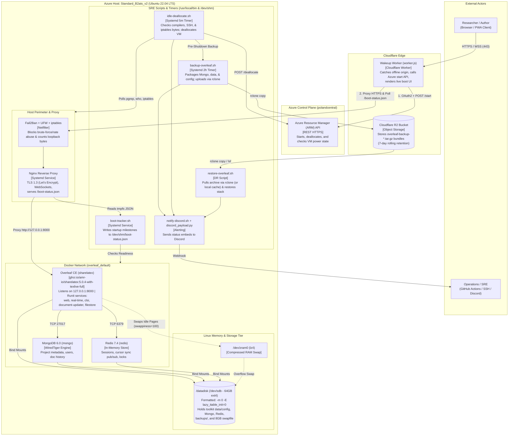
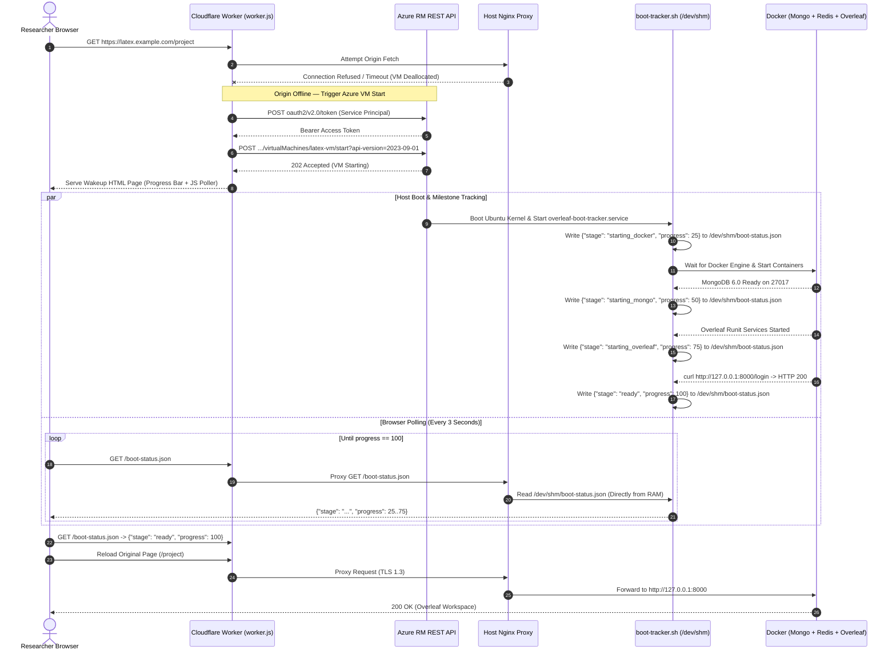
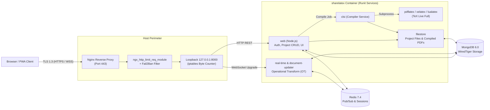
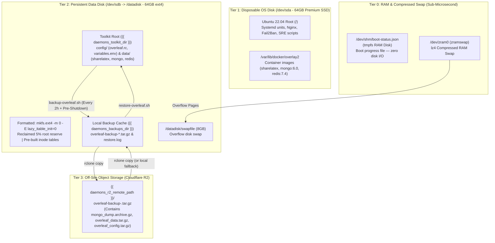
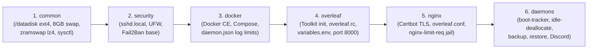

# MCLeaf — System Architecture & Internals

This specification details the architecture of **MCLeaf**, an in-house collaborative LaTeX platform engineered to replace SaaS suites like **prism.ai** for academic paper authoring. It covers container topologies, serverless edge wakeup mechanics, stateless/stateful storage separation, Linux kernel memory tuning, and off-site disaster recovery pipelines.

---

## 1. Core Architectural Invariants

MCLeaf is built around four core design principles:

1. **Disposable Compute, Durable State:** The OS disk (`/dev/sda`) and Docker runtime are completely ephemeral. All critical state—MongoDB WiredTiger database files, Redis persistence logs, user project sources, and toolkit configs—resides on a dedicated $64\text{ GB}$ data disk (`/dev/sdb` mounted at `/datadisk`) continuously synced to **Cloudflare R2**.
2. **Scale-to-Zero Without Sacrificing UX:** The VM deallocates after $30\text{ minutes}$ of idle silence to reach **$0/hr compute cost**. When a researcher visits the domain, a Cloudflare Edge Worker wakes the VM and displays live boot progress until the service is ready.
3. **Software & Kernel Tuning Over Hardware Sizing:** Rather than over-provisioning an expensive VM to absorb TeX Live's $150,000+$ font/macro files and heavy `pdflatex` compilation bursts, MCLeaf pairs `lz4`-compressed `zram`, an $8\text{ GB}$ dedicated disk swapfile, and VFS inode cache tuning (`vm.vfs_cache_pressure=50`) on a compact 2-vCPU burstable node (`Standard_B2ats_v2`).
4. **GitOps & Multi-Environment Isolation:** Infrastructure (`*.tf`), OS configuration (`ansible/roles/*`), and operational scripts are version-controlled and verified on `staging` (`LATEX-SHARED-CLONE`) before gated promotion to `production` (`LATEX-SHARED`).

---

## 2. C4 Container Diagram

---

## 3. Traffic Flows & Cold-Boot Wakeup Sequence

### 3.1 Waking Up a Deallocated VM
When the VM is deallocated, Azure stops billing for compute. Here is what happens when a user opens the site and wakes the server back up ($105\text{--}120\text{ s}$ end-to-end):

### 3.2 Normal Editing & Compilation Traffic
Once the VM is warm, requests flow through Nginx to the Overleaf container on loopback port `8000`:

1. **TLS & PWA Support:** Nginx (`ansible/roles/nginx/templates/overleaf.j2`) handles Let's Encrypt certificates, HSTS headers, PWA metadata, and allows up to `50m` request bodies for large figure uploads.
2. **WebSockets (`/socket.io/`):** Collaborative editing relies on persistent WebSocket connections. Nginx forwards `Upgrade` and `Connection` headers with extended timeouts so live cursors stay connected.
3. **Passive Traffic Counting:** Because Nginx proxies traffic to `http://127.0.0.1:8000`, a simple `iptables` rule on the loopback interface counts bytes flowing to Overleaf. `idle-deallocate.sh` reads that counter every 5 minutes instead of parsing Nginx logs.

---

## 4. Storage Layout & Tiering

MCLeaf splits storage across four tiers so container rebuilds or OS upgrades don't touch user data:

### Why We Format `/dev/sdb` with `-m 0 -E lazy_itable_init=0`
When Ansible formats `/dev/sdb` (`ansible/roles/common/tasks/main.yml`), it passes two specific flags to `mkfs.ext4`:
- **`-m 0`:** Standard `ext4` sets aside $5\%$ of the drive for `root` in case `/var/log` fills up the OS partition. Since `/datadisk` only holds application data and backups, `-m 0` gives us back **$3.2\text{ GB}$ of usable space** right away.
- **`-E lazy_itable_init=0`:** Normally, `ext4` finishes initializing inode tables in the background (`ext4lazyinit`) after the disk is mounted. On a burstable disk, that background I/O competes with MongoDB and TeX Live during initial setup. Initializing the inode tables upfront keeps disk latency predictable.

---

## 5. Linux Kernel & Memory Tuning

Running ~10 Node.js processes (via Runit inside the Overleaf container), MongoDB 6.0, Redis 7.4, and `pdflatex` on a 2-vCPU burstable VM works reliably because of three `sysctl` settings in `ansible/roles/common`:

### 5.1 `vm.swappiness = 100` + `zramswap` (`lz4`)
- **Why:** Overleaf runs several background Node.js services (`track-changes`, `contacts`, `notifications`, `spelling`) that sit mostly idle between actions, while `pdflatex` needs physical RAM and fast file cache reads during compilation bursts.
- **How it helps:** Setting `vm.swappiness = 100` with `zramswap` (`lz4`) encourages the kernel to compress idle Node.js memory pages in RAM ($\sim 3:1$ compression ratio) and push cold pages to `/datadisk/swapfile`, freeing up physical RAM for active compiles and filesystem caches.

### 5.2 `vm.overcommit_memory = 1`
- **Why:** When Redis runs a background save (`BGSAVE`) or Node.js spawns a compiler subprocess, Linux's default `fork()` check (`overcommit_memory = 0`) can reject the call with `ENOMEM` if the parent process has a large virtual address space—even though Copy-on-Write only needs a tiny amount of actual RAM.
- **How it helps:** `vm.overcommit_memory = 1` tells the kernel to allow those `fork()` calls so Redis snapshots and `pdflatex` spawns don't fail under memory pressure.

### 5.3 `vm.vfs_cache_pressure = 50`
- **Why:** Every time a user compiles a document, TeX Live's `kpsewhich` searches across directory trees containing over $150,000$ files. If the kernel drops directory and inode caches too aggressively, every compile turns into a disk-read storm.
- **How it helps:** Lowering `vfs_cache_pressure` from the default `100` to `50` keeps TeX directory and inode lookups cached in kernel memory much longer.

---

## 6. SRE Daemons & Scripts (`ansible/roles/daemons`)

All custom operational scripts are deployed by `ansible/roles/daemons` and read their credentials from `/etc/overleaf-secrets.env` (`0600` permissions).

### 6.1 Cold-Boot Tracker (`boot-tracker.sh`)
- **Unit:** `overleaf-boot-tracker.service`
- **Output:** `/dev/shm/boot-status.json`
- **What it does:** Watches the boot sequence and updates `/dev/shm/boot-status.json` as each layer comes online:
  1. `10%` — System initializing.
  2. `25%` — Docker daemon responding.
  3. `50%` — `mongo` container online and responding to ping.
  4. `75%` — `sharelatex` container running.
  5. `100%` — `http://127.0.0.1:8000/login` returns `HTTP 200 OK`.

### 6.2 Inactivity Deallocator (`idle-deallocate.sh`)
- **Units:** `overleaf-idle-check.timer` (every `5min`) $\rightarrow$ `overleaf-idle-check.service`.
- **What it checks:**
  1. **Active Compilers:** `pgrep -f "pdflatex|xelatex|lualatex|latexmk|bibtex|biber"`.
  2. **Logged-in Admins:** Active SSH/PTY sessions via `who`.
  3. **Web Traffic:** Byte delta on the loopback `iptables` counter for port `8000`.
- **Shutdown flow:** If all three checks are idle for 6 ticks ($30\text{ minutes}$), it runs `backup-overleaf.sh`, sends a Discord notification via `notify-discord.sh`, and calls the Azure ARM `/deallocate` API.

### 6.3 R2 Backup Script (`backup-overleaf.sh`)
- **Units:** `latex-backup.timer` (every `2h`) $\rightarrow$ `latex-backup.service`.
- **What it does:**
  1. Streams a compressed MongoDB dump (`docker exec mongo mongodump --archive --gzip`) to `mongo_dump.archive.gz`.
  2. Archives `${TOOLKIT_DIR}/data` into `overleaf_data.tar.gz` and `${TOOLKIT_DIR}/config` into `overleaf_config.tar.gz`.
  3. Packs those artifacts into a timestamped `overleaf-backup-<timestamp>.tar.gz` bundle in `${BACKUP_DIR}`.
  4. Uploads the bundle to Cloudflare R2 using `rclone`, prunes archives older than **7 days**, and posts a summary embed to Discord.

### 6.4 Disaster Recovery Script (`restore-overleaf.sh`)
- **Triggered by:** Manual CLI run or `.github/workflows/recovery.yml` (`workflow_dispatch`).
- **Error Handling & Logging:** Uses `set -euo pipefail` and `trap 'on_error ${LINENO}' ERR`. Every step logs with UTC timestamps to `${BACKUP_DIR}/restore.log`. If any command fails, `on_error` logs the exact line number and exit code and sends an `"emergency"` Discord alert.
- **Step-by-Step Execution:**
  1. **Load Secrets:** Sources `/etc/overleaf-secrets.env` (exits and alerts if unreadable).
  2. **3-Tier Archive Resolution:** Determines which `overleaf-backup-*.tar.gz` file to restore in priority order:
     - **Priority 1:** Explicit filename passed as `$1`.
     - **Priority 2:** Newest `overleaf-backup-*.tar.gz` in Cloudflare R2 via `rclone lsf --sort time --reverse "${R2_REMOTE_BUCKET}/"`.
     - **Priority 3:** Newest local archive in `${BACKUP_DIR}/overleaf-backup-*.tar.gz` (allows recovery even if R2 is temporarily unreachable).
  3. **Fetch & Verify Integrity:** If `${BACKUP_DIR}/${TARGET}` is not already cached locally on disk, downloads it into a temporary working folder (`${BACKUP_DIR}/temp_restore_${START_TIME}`, auto-cleaned on `EXIT`) via `rclone copy --retries 3`. Runs `tar -tzf` to verify the outer archive is intact, unpacks it, and checks that both `mongo_dump.archive.gz` and `overleaf_data.tar.gz` exist inside.
  4. **Quiesce & Restore State:**
     - Stops `sharelatex` (`docker stop sharelatex`) while ensuring the `mongo` container is running.
     - Restores MongoDB via `docker exec -i mongo mongorestore --archive --gzip --drop < "${DEST}/mongo_dump.archive.gz"`.
     - Extracts `overleaf_data.tar.gz` with `--overwrite --same-owner` into `${TOOLKIT_DIR}/data`.
     - If `overleaf_config.tar.gz` is present in the bundle, extracts it into `${TOOLKIT_DIR}` and resets ownership of `${TOOLKIT_DIR}/config` to `{{ ansible_user }}:{{ ansible_user }}`.
  5. **Start & Health Check:** Starts `sharelatex` and polls `http://127.0.0.1:8000/login` every $2\text{ s}$ (up to 30 attempts / $60\text{ s}$). On `HTTP 200`, sends a `"success"` Discord alert with the total recovery duration; on timeout, sends an `"emergency"` alert containing the last 8 lines of `docker logs sharelatex`.

---

## 7. Terraform & Ansible Workflow

### 7.1 Terraform Files (`*.tf`)
- **`terraform.tf`, `provider.tf`, `backend.tf`:** Configures the AzureRM provider and remote state backend.
- **`main.tf` & `variables.tf`:** Creates the Resource Group (`LATEX-SHARED` or `LATEX-SHARED-CLONE`), VNet/Subnet, NSG (`22`, `80`, `443`), Static Public IP, NIC, $64\text{ GB}$ OS SSD, $64\text{ GB}$ Data Disk (`lun=0`), and the `Standard_B2ats_v2` Linux VM.
- **`keys.tf` & `roles.tf`:** Configures SSH keys and grants the Service Principal permission to start, deallocate, and query the VM.
- **`inventory.tf` & `outputs.tf`:** Generates `ansible/inventory/hosts.ini` automatically after `terraform apply`.

### 7.2 Ansible Role Order (`ansible/playbooks/site.yml`)
